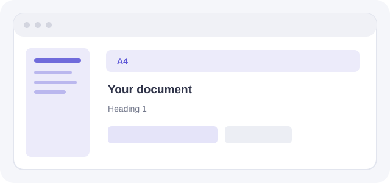

# Brightdesk Pages




Create letters, reports and formatted documents.

**Brightdesk Pages** is a desktop document editor for writing and formatting your work. It is delivered through a desktop installer for your computer.

## What you can do

Create letters, reports and formatted documents with familiar editing and page-layout tools.

## Desktop installers

Choose the installer for your computer:

| Computer | Installer |
| --- | --- |
| Windows | Windows x64 installer (.exe) |
| macOS | Universal installer (.dmg), package (.pkg) or archive (.zip) |
| Linux | Portable Linux package or Debian package (.deb) |

Installers are published here after the release checks have passed and a release has been approved.

## Run from source

Use Node.js **24.22.2**.

```sh
npm ci
npm start
```

To build and verify an installer on its native operating system:

```sh
npm run dist:desktop:mac
npm run verify:desktop:mac
```

Use `win` on Windows or `linux` on Linux instead of `mac`.

## Project files

- `src/` — the Brightdesk Pages editor and supporting desktop code.
- `assets/brightdesk-pages.svg` — Brightdesk Pages preview artwork.
- `scripts/` — build and release verification tools.
- `tests/` — automated checks.

## Related project

[Brightdesk Office Suite](https://github.com/connormolloy12/Brightdesk-suite) brings the approved Brightdesk products together in one desktop installation.

## Private maintenance checks

The Brightdesk-Pages maintenance controller checks each approved private project from its default `main` branch. It uses short-lived, repository-scoped Contents: read-only tokens. For a failed Brightdesk Suite test run, a separate Issues-only token may post a bounded diagnostic containing failing test names to the private Suite maintenance issue. A one-time request can build Brightdesk Suite for Windows, macOS and Linux, verify the expected packages and checksums, and run native temporary install/launch/uninstall smoke tests. Private source files, assertion details, stack traces, raw test logs and installer binaries are not published in this public repository; build files are kept only on ephemeral runners.

## Identity and licence

Brightdesk is independent and is not affiliated with Microsoft. It uses original product names, code, interface design and artwork. See [LICENSE](LICENSE), [TERMS_AND_CONDITIONS.txt](TERMS_AND_CONDITIONS.txt), and [THIRD_PARTY_NOTICES.md](THIRD_PARTY_NOTICES.md).
