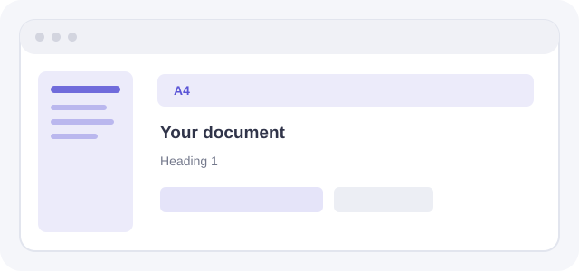

# Brightdesk Pages




Create letters, reports and formatted documents.

Brightdesk is an independent desktop product. This repository is the standalone edition of **Brightdesk Pages**. It uses the shared Brightdesk desktop engine and opens directly into this app, with app switching disabled.

## What this app does

Create letters, reports and formatted documents.

## Download

The latest standalone installers are published from this repository's verified release workflow when a release is approved.

| Platform | Installer |
| --- | --- |
| Windows | Windows x64 installer (.exe) |
| macOS | Universal installer (.dmg), package (.pkg) and archive (.zip) |
| Linux | x64 AppImage and Debian package (.deb) |

The complete ten-app desktop suite remains available from [Brightdesk-suite](https://github.com/connormolloy12/Brightdesk-suite).

## Run from source

Use Node.js **24.22.2**.

```sh
npm ci
npm start
```

To build an installer on its native operating system:

```sh
npm run dist:app:mac
npm run verify:app:mac
```

Use `win` on Windows or `linux` on Linux instead of `mac`.

## Project structure

- `src/` — Brightdesk desktop renderer and app modules.
- `assets/brightdesk-app.svg` — original preview artwork for this app.
- `scripts/` — build and release verification tools.
- `tests/` — automated app and shared-engine tests.

## Related project

[Brightdesk Office Suite](https://github.com/connormolloy12/Brightdesk-suite) brings all ten approved Brightdesk apps together in one desktop installer.

## Identity and licence

Brightdesk is independent and is not affiliated with Microsoft. It uses original product names, code, interface design and artwork. See [LICENSE](LICENSE), [TERMS_AND_CONDITIONS.txt](TERMS_AND_CONDITIONS.txt), and [THIRD_PARTY_NOTICES.md](THIRD_PARTY_NOTICES.md).
